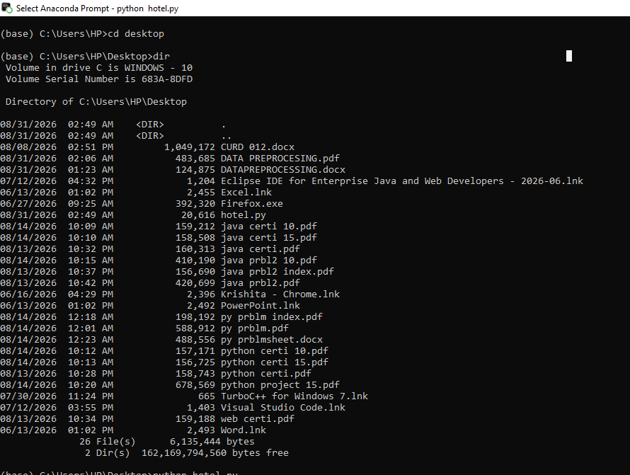
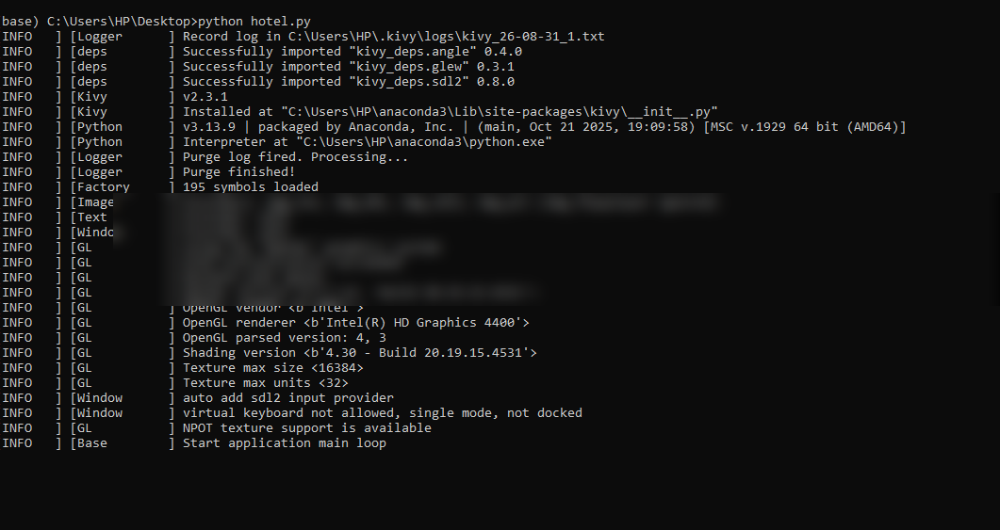
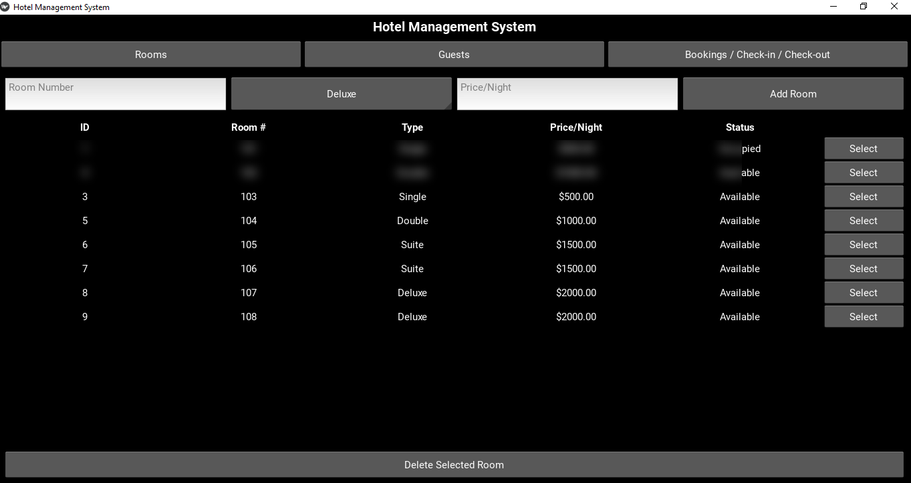
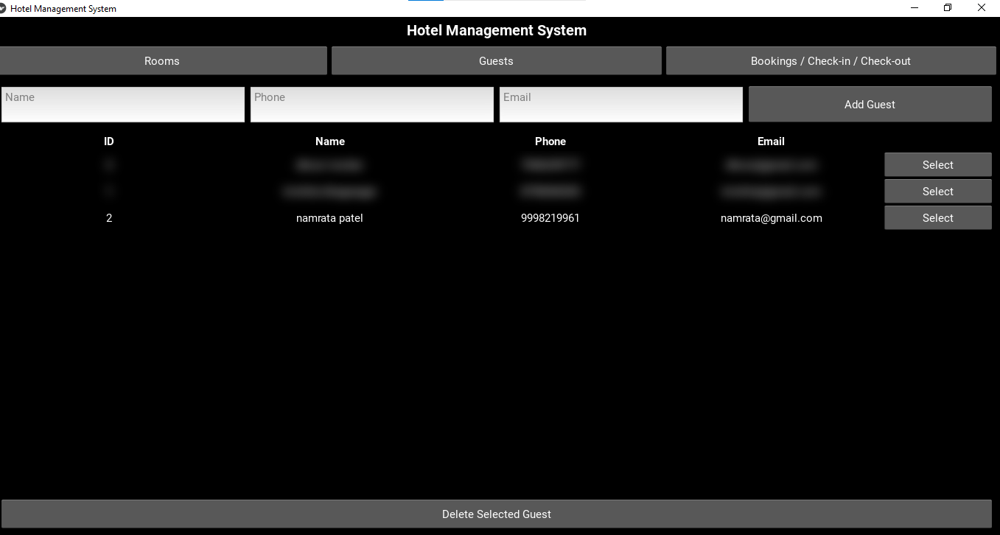

# 🏨 Hotel Management System

A desktop **Hotel Management System** built with **Python, Kivy, and SQLite**.  
The application provides a graphical interface for managing rooms, guests, and hotel bookings, including check-in, check-out, booking history, and automatic bill calculation.

## ✨ Features

### 🛏️ Room Management
- Add rooms with room number, room type, and price per night
- Supported room types: Single, Double, Suite, Deluxe
- View room availability
- Delete selected rooms
- Prevent duplicate room numbers

### 👤 Guest Management
- Add guest name, phone, and email
- View registered guests
- Delete selected guest records

### 📅 Booking Management
- Select a guest and an available room for check-in
- Automatically change room status to **Occupied**
- View active bookings
- Check out selected bookings
- Automatically calculate the bill from nights stayed × room price
- Preserve completed bookings in booking history
- Return checked-out rooms to **Available**

## 🖥️ Screenshots

### Rooms Management


### Guest Management


### Booking Management


### Checkout & Bill Calculation


> Screenshots use demonstration/redacted data for privacy.

## 🛠️ Technologies Used

| Technology | Purpose |
|---|---|
| **Python 3.8+** | Application programming |
| **Kivy** | Graphical user interface |
| **SQLite** | Local database |
| **sqlite3** | Python database interface |
| **datetime** | Date and billing calculations |

## 🗄️ Database

The application creates a local SQLite database named:

```text
hotel.db
```

The database contains three main tables:

- `rooms` — room number, type, nightly price, and availability
- `guests` — guest name, phone, and email
- `bookings` — room, guest, check-in/check-out, status, and total bill

The database file is created automatically when the application is first run.

## 🏗️ Application Architecture

The project is organized into three main layers:

```text
Database Layer
      ↓
UI Helper Layer
      ↓
Screen Layer
      ↓
Application Shell
```

### Database Layer
The `Database` class handles SQLite operations such as creating tables, adding/deleting records, creating bookings, checking out bookings, and retrieving booking information.

### UI Helper Layer
Reusable components handle popups, table rows, and scrollable table views.

### Screen Layer
The application contains:

- `RoomsScreen`
- `GuestsScreen`
- `BookingsScreen`

A `ScreenManager` is used to switch between screens.

## 📁 Project Structure

```text
Hotel-Management-System-Kivy/
│
├── Hotel-Management-System.py
├── README.md
├── requirements.txt
├── .gitignore
│
└── screenshots/
    ├── rooms.png
    ├── guests.png
    ├── bookings.png
    └── checkout-result.png
```

## 🚀 Installation & Running

### 1. Clone the repository

```bash
git clone https://github.com/krishitabhagwagar1710-maker/Hotel-Management-System-Kivy.git
```

### 2. Open the project folder

```bash
cd Hotel-Management-System-Kivy
```

### 3. Install dependencies

```bash
pip install -r requirements.txt
```

### 4. Run the application

```bash
python Hotel-Management-System.py
```

On first launch, `hotel.db` is automatically created in the project folder.

## 🔄 Application Workflow

```text
Add Rooms
   ↓
Add Guests
   ↓
Select Guest + Available Room
   ↓
Check-In
   ↓
Room becomes Occupied
   ↓
Active Booking
   ↓
Check-Out
   ↓
Automatic Bill Calculation
   ↓
Room becomes Available
   ↓
Booking History Updated
```

## 🔒 Data Integrity

The application includes basic data-integrity rules:

- Room numbers must be unique.
- Only available rooms can be selected for check-in.
- Check-in changes a room to **Occupied**.
- Check-out changes a room back to **Available**.
- Completed bookings remain in booking history.
- SQLite foreign keys are enabled for room and guest relationships.

## ⚠️ Current Limitations

The current version does not include:

- Staff login/authentication
- Search and filtering
- PDF invoice/receipt export
- Editing existing rooms or guests
- Network/multi-user database support
- Future date-range room availability

The current application is designed for **single-user, single-computer use** with a local SQLite database.

## 🔮 Future Enhancements

Possible future improvements include:

- User authentication and role-based access
- Search and filtering
- Edit functionality for rooms and guests
- PDF invoice generation
- Date-range room availability
- Improved dashboard and reports
- Mobile packaging using Buildozer

## 📚 Documentation

The project documentation explains the requirements, features, database structure, code architecture, business logic, limitations, and troubleshooting steps.

## 👩‍💻 Author

**Bhagwagar Krishita**  
B.Sc.IT — Hotel Management System using Kivy

---

⭐ If you find this project useful, consider giving the repository a star.
